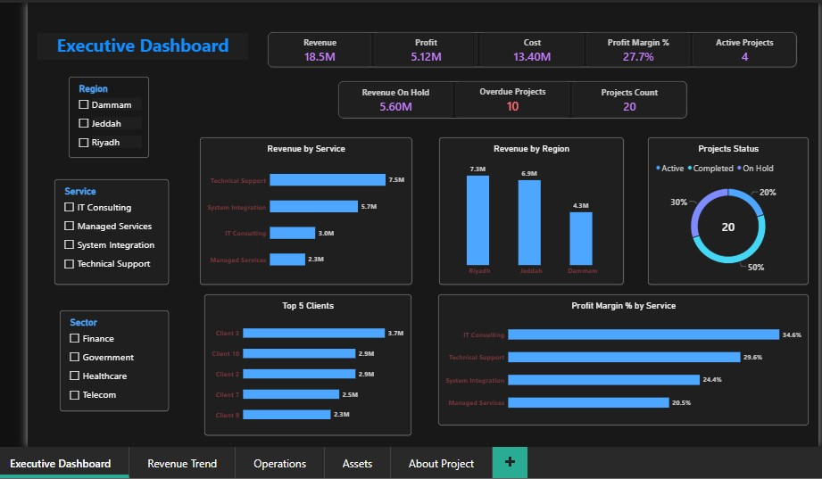

<div dir="rtl">

# MIS Executive Analytics: المشاريع والعمليات والأصول

[English](README.md) | **العربية**

مشروع ذكاء أعمال متكامل لشركة خدمات تقنية: نموذج بيانات على SQL Server، وتقرير Power BI، ولوحة HTML تفاعلية للإدارة التنفيذية. يجيب المشروع عن سؤال واحد: **أين تحقق الشركة أرباحها فعلاً، وأين يكمن الخطر؟**

**اللوحة التفاعلية:** [افتح اللوحة التفاعلية](https://salehmsa.github.io/MIS-Project1-Analytics/dashboard/)
**المطوّر:** صالح محبوب · [GitHub: Salehmsa](https://github.com/Salehmsa)



---

## 1. الأسئلة التي يجيب عنها المشروع

| المجال | السؤال |
|---|---|
| الربحية | أي الخدمات والقطاعات والمناطق تحقق أفضل هامش ربح، وليس فقط أعلى إيراد؟ |
| مخاطر المحفظة | كم قيمة العقود المعلّقة؟ وكم مشروعاً تجاوز موعد انتهائه المخطط؟ |
| مخاطر العملاء | ما درجة تركّز الإيراد في أكبر العملاء؟ |
| عمليات الدعم | كم تذكرة مفتوحة؟ وما سرعة الحل؟ وهل تؤثر الأولوية في سرعة المعالجة؟ |
| الأصول | ما نسبة الأصول التي ما زالت في الخدمة؟ |

## 2. أهم النتائج

| # | النتيجة | الدليل |
|---|---|---|
| 1 | **أعلى إيراد لا يعني أعلى ربح.** الدعم الفني الأعلى إيراداً (7.54 م) بهامش 29.6%، بينما الاستشارات التقنية الأعلى هامشاً (34.6%) بإيراد 2.96 م. والخدمات المُدارة الأضعف (20.5%). | الهامش حسب الخدمة |
| 2 | **47% فقط من قيمة العقود محقق.** 8.64 م من أصل 18.53 م مشاريع مكتملة، و5.60 م (30%) في مشاريع معلّقة. | الإيراد المحقق مقابل المعلّق |
| 3 | **كل المشاريع غير المكتملة تجاوزت موعدها المخطط** (10 من 10). إما أن حالاتها قديمة أو أن المحفظة متأخرة بالكامل. | المشاريع المتأخرة |
| 4 | **أكبر 3 عملاء = 51.8% من الإيراد.** العميل 3 وحده 3.71 م. | تركّز العملاء |
| 5 | **القطاع الحكومي الأضعف ربحية** بهامش 19.4%، والاتصالات الأقوى (32.6%). | الهامش حسب القطاع |
| 6 | **7 من 10 تذاكر عالية الأولوية ما زالت مفتوحة**، ولا تُحل أسرع من غيرها (متوسط 14.3 ساعة مقابل 11.6 للمنخفضة). | صفحة العمليات |
| 7 | **58% من الأصول (23 من 40) خارج الخدمة** بقيمة 1.38 م، أي نحو 52% من القيمة الإجمالية. والشبكات الأسوأ (8 من 12). | صفحة الأصول |
| 8 | **العميل 3 هو الأكبر إيراداً وأكبر عبء دعم مفتوح** (13 تذكرة، 8 منها مفتوحة). | التذاكر حسب العميل |

## 3. نموذج البيانات

```
DimClients ──┬──< FactProjects >── DimServices
             │        │   │
             │        │   └──< FactTickets      (العميل مشتق عبر المشروع)
             └──< FactAssets
                      │
        DimDate ──< FactProjects  (علاقة فعّالة على StartDate)
```

- **المصدر:** قاعدة SQL Server باسم `MIS_Learning` (5 جداول: العملاء والخدمات والمشاريع والتذاكر والأصول) مع مفاتيح أساسية وأجنبية وقيود تحقق.
- **طبقة التقارير:** ثلاثة Views هي `vw_ProjectFinancials` و`vw_TicketsEnriched` و`vw_AssetsEnriched`.
- **Power BI:** نموذج نجمي (Star Schema) مع جدول تواريخ مستقل وجدول مخصص للمقاييس.

## 4. العمل على جودة البيانات (ما وجدته وما أصلحته)

كانت في البيانات الأصلية مشاكل تُفسد المؤشرات بصمت، وكان كشفها وإصلاحها معظم العمل.

| المشكلة | الأثر | الحل |
|---|---|---|
| **كل التذاكر "المفتوحة" الـ27 لها تاريخ إغلاق وساعات حل** | عدّ المفتوح والمغلق وSLA غير موثوقين | مسح الحقلين للتذاكر المفتوحة، وإضافة القيد `CK_Tickets_OpenClosed` حتى لا يتكرر |
| **عميل التذكرة لا يطابق عميل مشروعها في 45 من 50 تذكرة** | مساران متعارضان من العميل إلى التذاكر | حذف `Tickets.ClientID`، والعميل يُشتق عبر `ProjectID` |
| **مقياس `Assets Value` يجمع الأصول المتقاعدة أيضاً** | تضخيم رأس المال العامل بمقدار 1.38 م | إضافة `Assets Value In Service` و`Assets Value Retired` |
| **الإيراد يشمل المشاريع المعلّقة** | قيمة العقود تُقرأ كأنها إيراد محقق | إضافة `Revenue Completed` و`Revenue On Hold` |
| **`Avg Monthly Revenue` يقسم على 12 ثابتاً** | متوسط خاطئ تحت أي فلتر | القسمة على عدد الأشهر التي بها مشاريع فعلاً |
| **`Revenue YTD` يعود للصفر كل يناير، وفلتر قديم على المخطط أخفى 2026** | بدا الإيراد وكأنه انهار | استبداله بمقياس تراكمي وحذف الفلتر |
| **`SLA %` يقسم على كل التذاكر** | التذاكر المفتوحة تشوّه النسبة | القسمة على التذاكر المغلقة فقط |
| **نص "Key Insights" ثابت** | لا يتغير مع الفلاتر | إعادة بنائه كمقاييس DAX نصية ديناميكية |

بنود مفتوحة موثّقة ولم تُخفَ: 34 من 50 تذكرة تاريخ إنشائها خارج الفترة الزمنية لمشروعها، ولا توجد في البيانات عملة محددة.

## 5. أهم مقاييس DAX

```dax
Revenue Completed =
CALCULATE([Revenue], FactProjects[Status] = "Completed")

Revenue On Hold =
CALCULATE([Revenue], FactProjects[Status] = "On Hold")

Overdue Projects =
COUNTROWS(FILTER(FactProjects,
    FactProjects[Status] <> "Completed" && FactProjects[EndDate] < TODAY()))

SLA % =
DIVIDE([Resolved Within SLA], [Closed Tickets])

Months With Projects =
COUNTROWS(FILTER(VALUES(DimDate[YearMonth]), [Revenue] > 0))

Avg Monthly Revenue =
DIVIDE([Revenue], [Months With Projects])

Assets Value In Service =
CALCULATE(SUM(FactAssets[AssetValue]), FactAssets[Status] = "Active")
```

## 6. هيكل المستودع

```
├── README.md                       # بالإنجليزية
├── README.ar.md                    # بالعربية
├── index.html                      # يحوّل إلى اللوحة
├── sql/
│   └── MIS_Learning_Clean.sql      # بناء + تحميل + تحقق + استعلامات تحليلية
├── data/                           # 5 ملفات CSV نظيفة يستخدمها السكربت
├── powerbi/
│   └── MIS_Executive_Operations_Assets_Dashboard.pbix
├── dashboard/
│   └── index.html                  # اللوحة التفاعلية (GitHub Pages)
└── docs/screenshots/
```

## 7. طريقة التشغيل

**SQL Server**
1. انسخ مجلد `data/` إلى `C:\MIS_Project\data\`، أو عدّل المتغير `@DataDir` في القسم 4 من السكربت.
2. شغّل الأقسام من 0 إلى 5 في `sql/MIS_Learning_Clean.sql`. السكربت قابل لإعادة التشغيل: يحذف الجداول ويعيد بناءها.
3. تأكد أن الاستعلام 5.1 يعرض `OK` للجداول الخمسة، ثم شغّل أي استعلام تحليلي من الأقسام 7 إلى 10.

**Power BI:** افتح ملف `.pbix` ثم *Home ← Refresh*. الخادم: نسخة SQL Server لديك، والقاعدة `MIS_Learning`.

**اللوحة التفاعلية:** افتح `dashboard/index.html` في المتصفح مباشرة. تعمل دون إنترنت، وتدعم العربية والإنجليزية والوضعين الفاتح والداكن، وفلاتر عامة حسب المنطقة والقطاع والخدمة وحالة المشروع.

## 8. التقنيات المستخدمة

SQL Server (T-SQL، القيود، الـViews، دوال النوافذ، CTEs) · Power BI (نمذجة البيانات، DAX، ذكاء الوقت) · HTML/CSS/JavaScript (لوحة تفاعلية مستقلة) · Python (التحقق من البيانات)

## 9. الافتراضات والحدود

- البيانات عيّنة (10 عملاء، 20 مشروعاً، 50 تذكرة، 40 أصلاً)؛ الأرقام توضّح المنهج وليست لشركة حقيقية.
- "الإيراد" يعني قيمة العقد الكاملة بغض النظر عن حالته، وتُنسب إلى شهر بدء المشروع.
- حد الـSLA البالغ 8 ساعات افتراض؛ يمكن تغييره من محدد اللوحة أو من الاستعلام 8.4.
- "متأخر" يعني مشروعاً غير مكتمل تاريخ انتهائه المخطط قبل اليوم.
- لا توجد عملة محددة في الملفات المصدرية.

</div>