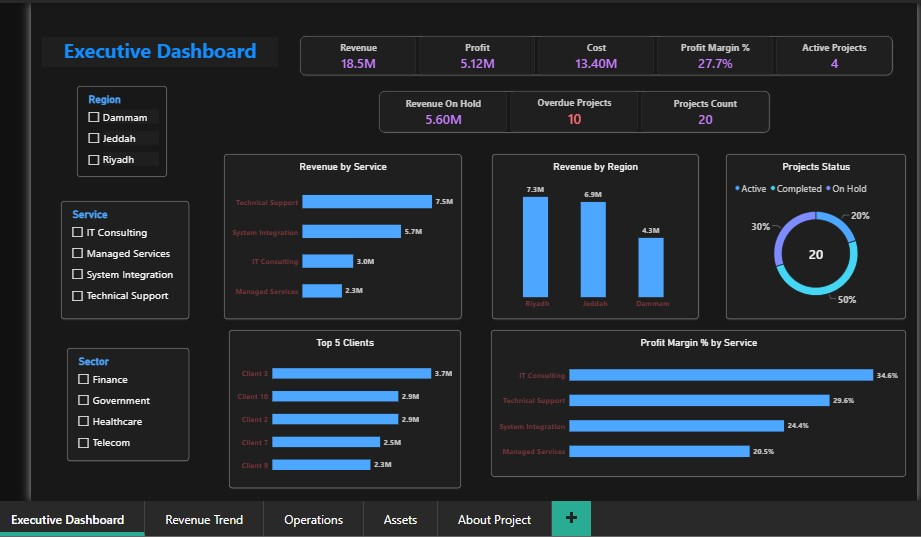

# MIS Executive Analytics: Projects, Operations & Assets

An end-to-end business intelligence project for an IT services company: a SQL Server data model, a Power BI report, and an interactive HTML executive dashboard, built to answer one question for management: **where does the company actually make money, and where is the risk?**

> **Live dashboard:** `https://salehmsa.github.io/MIS-Project1-Analytics/dashboard/` *(enable GitHub Pages, see below)*
> **Author:** Saleh Mahbub · [GitHub: Salehmsa](https://github.com/Salehmsa)



---

## 1. Business questions

| Area | Question |
|---|---|
| Profitability | Which services, sectors and regions make the best margin, not just the most revenue? |
| Portfolio risk | How much contract value is on hold, and how many projects are past their planned end date? |
| Client risk | How concentrated is revenue in the biggest clients? |
| Support operations | How many tickets are open, how fast are they resolved, and does priority change handling speed? |
| Assets | How much of the asset base is still in service? |

## 2. Key findings

| # | Finding | Evidence |
|---|---|---|
| 1 | **Biggest revenue is not biggest profit.** Technical Support leads revenue (7.54M) at 29.6% margin, while IT Consulting has the best margin (34.6%) with 2.96M. Managed Services is weakest at 20.5%. | Margin by service |
| 2 | **Only 47% of contract value is realised.** 8.64M of 18.53M comes from completed projects. 5.60M (30%) sits in on-hold projects. | Revenue Completed vs Revenue On Hold |
| 3 | **Every unfinished project is past its planned end date** (10 of 10). Either statuses are stale or the whole portfolio is late. | Overdue Projects |
| 4 | **Top 3 clients = 51.8% of revenue.** Client 3 alone is 3.71M. | Client concentration |
| 5 | **Government is the weakest sector** at 19.4% margin; Telecom the strongest at 32.6%. | Margin by sector |
| 6 | **7 of 10 high-priority tickets are still open**, and high-priority tickets are not resolved faster (14.3h average vs 11.6h for low priority). | Operations page |
| 7 | **58% of assets (23 of 40) are retired**, worth 1.38M, about 52% of total asset value. Network equipment is the worst case (8 of 12 retired). | Assets page |
| 8 | **Client 3 is both the largest client and the biggest open-support load** (13 tickets, 8 open). | Tickets by client |

## 3. Data model

```
DimClients ──┬──< FactProjects >── DimServices
             │        │   │
             │        │   └──< FactTickets      (client derived through the project)
             └──< FactAssets
                      │
        DimDate ──< FactProjects  (active on StartDate)
```

- **Source:** SQL Server database `MIS_Learning` (5 tables: Clients, Services, Projects, Tickets, Assets) with primary keys, foreign keys and check constraints.
- **Reporting layer:** three SQL views (`vw_ProjectFinancials`, `vw_TicketsEnriched`, `vw_AssetsEnriched`).
- **Power BI:** star schema with a separate date dimension and a dedicated measures table.

## 4. Data quality work (what I found and fixed)

The original data had problems that silently corrupted the KPIs. Finding and fixing them was most of the work.

| Problem | Impact | Fix |
|---|---|---|
| **All 27 "Open" tickets had a closed date and resolution hours** | Open/closed counts and SLA were unreliable | Cleared both fields for open tickets; added `CK_Tickets_OpenClosed` so it cannot recur |
| **Ticket client did not match the project's client in 45 of 50 tickets** | Two conflicting paths from client to tickets | Dropped `Tickets.ClientID`; client is derived through `ProjectID` |
| **`Assets Value` summed retired assets too** | Overstated working capital by 1.38M | Added `Assets Value In Service` and `Assets Value Retired` |
| **Revenue included on-hold projects** | Contract value read as realised revenue | Added `Revenue Completed` and `Revenue On Hold` |
| **`Avg Monthly Revenue` divided by a fixed 12** | Wrong average under any filter | Divides by months that actually have projects |
| **`Revenue YTD` reset every January and a stale visual filter hid 2026** | Trend chart looked like revenue collapsed | Replaced with a cumulative measure; removed the filter |
| **`SLA %` divided by all tickets** | Open tickets distorted the rate | Divides by closed tickets only |
| **Static "Key Insights" text** | Never changed with filters | Rebuilt as dynamic DAX text measures |

Known open items, documented rather than hidden: 34 of 50 tickets are dated outside their project's start-end window, and the dataset has no currency field.

## 5. Key DAX measures

```dax
Revenue Completed =
CALCULATE([Revenue], FactProjects[Status] = "Completed")

Revenue On Hold =
CALCULATE([Revenue], FactProjects[Status] = "On Hold")

Overdue Projects =
COUNTROWS(FILTER(FactProjects,
    FactProjects[Status] <> "Completed" && FactProjects[EndDate] < TODAY()))

SLA % =
DIVIDE([Resolved Within SLA], [Closed Tickets])

Months With Projects =
COUNTROWS(FILTER(VALUES(DimDate[YearMonth]), [Revenue] > 0))

Avg Monthly Revenue =
DIVIDE([Revenue], [Months With Projects])

Assets Value In Service =
CALCULATE(SUM(FactAssets[AssetValue]), FactAssets[Status] = "Active")
```

## 6. Repository structure

```
├── README.md
├── sql/
│   └── MIS_Learning_Clean.sql      # rebuild + load + validate + analysis queries
├── data/                           # 5 clean CSV files used by the script
├── powerbi/
│   └── MIS_Executive_Operations_Assets_Dashboard.pbix
├── dashboard/
│   └── index.html                  # interactive executive dashboard (GitHub Pages)
└── docs/screenshots/
```

## 7. How to run

**SQL Server**
1. Copy `data/` to `C:\MIS_Project\data\` (or edit `@DataDir` in section 4).
2. Run sections 0 to 5 of `sql/MIS_Learning_Clean.sql`. The script is re-runnable: it drops and rebuilds all tables.
3. Check that query 5.1 shows `OK` for all five tables, then run any analysis query from sections 7 to 10.

**Power BI:** open the `.pbix`, then *Home → Refresh*. Server: your SQL Server instance, database `MIS_Learning`.

**HTML dashboard:** open `dashboard/index.html` in a browser. It works offline, supports Arabic/English, light/dark mode, and global filters by region, sector, service and project status.

**Publish on GitHub Pages:** *Settings → Pages → Deploy from branch → `main` / `/ (root)`* (the root `index.html` redirects to `dashboard/`).

## 8. Tech stack

SQL Server (T-SQL, constraints, views, window functions, CTEs) · Power BI (data modelling, DAX, time intelligence) · HTML/CSS/JavaScript (self-contained interactive dashboard) · Python (data validation)

## 9. Assumptions and limits

- The dataset is a sample (10 clients, 20 projects, 50 tickets, 40 assets); figures illustrate the method, not a real company.
- "Revenue" means full contract value regardless of status, booked in the project's start month.
- The SLA limit of 8 hours is an assumption; change it in the dashboard selector or in query 8.4.
- "Overdue" means not completed with a planned end date before today.

---

## ملخص بالعربية

مشروع ذكاء أعمال متكامل لشركة خدمات تقنية: قاعدة بيانات SQL Server، وتقرير Power BI، ولوحة HTML تفاعلية ثنائية اللغة. أهم ما كشفه: الخدمة الأعلى إيراداً ليست الأعلى ربحاً، و30% من قيمة العقود معلّقة، وكل المشاريع غير المكتملة تجاوزت موعدها، و58% من الأصول خارج الخدمة. وفي المشروع توثيق كامل للأخطاء التي وُجدت في البيانات وكيف عولجت.
